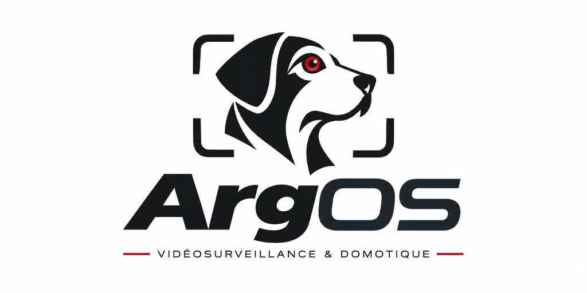

<p align="center">
  
</p>

<!-- Compteurs publiés avec le site de doc (Deploy docs) : aucun commit de bot. -->
<p align="center">
  
  
</p>

# Plateforme de vidéosurveillance IP auto-hébergée

**ArgOS** est conçue pour rester générique et multi-marques : caméras RTSP/ONVIF, enregistrement, live, événements, puis détection et PTZ au fil des versions. Le nom évoque à la fois le chien d’Ulysse et Argos Panoptès (la vigilance à plusieurs yeux). Le projet est né d’un besoin de surveillance locale sur une grande propriété ; l’objectif logiciel est un produit self-hosted, sans dépendance cloud propriétaire.

## Documentation fonctionnelle et technique

<p align="center">
  <a href="https://ulyssoulv.github.io/ArgOS/">
    
  </a>
</p>

Publiée par GitHub Pages à chaque merge sur `main` qui touche `docs/` ou `docs-site/`, et à chaque release.

## Quoi

Version **0.1.0** : trois **Caméras simulées** (`cam1`, `cam2`, `cam3`). MediaMTX diffuse en boucle une vidéo de dev par Caméra (H.264 1280×720, sans réencodage), joignable en RTSP et visible dans un navigateur (HLS, WebRTC), en local et sur le réseau local.

Version **0.2.0** : l’**API du Site** (FastAPI + PostgreSQL). L’Administrateur s’y connecte, gère les Caméras du Site, et l’API sonde leur état (`unknown` / `online` / `offline`).

Version **0.3.0** : l’**UI** (React, conteneur `web`). L’Administrateur se connecte sur `http://localhost:8080` (`https://localhost` depuis la 0.6.1), gère les Caméras dans l’onglet **Administration** et regarde leur Flux en WebRTC dans l’onglet **Live**, une Caméra active à la fois. MediaMTX sert de **pont** : l’API lui fait relayer toute Caméra active sur un chemin `camera-<id>`.

Version **0.4.0** : les Caméras simulées deviennent trois hôtes distincts (`camera-simulee-1` à `-3`, RTSP sur le port 554, l’une protégée par un identifiant), déclarés par un fichier Compose de simulation, `compose.simulation.yaml`, absent de la prod. Depuis l’Administration, une **Détection** cherche sur le réseau du Site les hôtes qui répondent en RTSP et les liste comme **Candidats** (voir [Réseau et Détection](docs/cameras/reseau-et-detection.md)).

Version **0.4.1** : **Ajouter** sur un Candidat, ou **Ajouter par adresse IP**, fait chercher son Flux par ArgOS sur les chemins courants des caméras, demande un mot de passe ou un chemin seulement s’il le faut, et montre l’**Aperçu** avant d’ajouter la Caméra : plus d’URL RTSP à écrire (voir [Ajouter une Caméra](docs/cameras/ajouter-une-camera.md)). Voir la [feuille de route de dev](docs/dev/feuille-de-route/feuille-de-route-dev.md).

Version **0.4.2** : ArgOS reconnaît l’**Appareil** de chaque Caméra par son **adresse MAC** (affichée au format `aa:bb:cc:dd:ee:ff` sur les Candidats, les Caméras et l’Aperçu). Une Détection qui retrouve un Appareil connu à une autre IP met à jour seule l’URL RTSP de ses Caméras (**adresse mise à jour**) ; une Caméra dont l’IP répond avec une autre MAC passe `offline` (**autre appareil à cette adresse**) et n’est plus relayée. **Filtrer par MAC** retrouve parmi les Candidats la caméra de l’étiquette. En prod Linux, l’API rejoint pour cela le réseau des caméras (macvlan, `compose.reseau-cameras.yaml`)  (voir [Réseau et Détection](docs/cameras/reseau-et-detection.md)).

Version **0.5.0** : les Caméras **H.265** (HEVC) se voient dans le Live et l’Aperçu, **sans réencodage**. ArgOS retient le **codec** de chaque Caméra (relevé à l’ajout, suivi par la sonde, affiché dans l’Administration) et choisit le transport d’après lui : WebRTC pour le H.264, **LL-HLS** pour le H.265, décodé par le navigateur (voir la documentation). Une quatrième Caméra simulée, `camera-simulee-4`, diffuse en H.265.

Version **0.6.0** : chaque Caméra active a des **Réglages** dans l’Administration. ArgOS lit la caméra par **ONVIF**, sans son interface web ni le cloud du fabricant, et règle ses **Incrustations** (texte, coin et affichage du nom et de la date et heure) et son **Horloge** (fuseau, mise à l’heure du Site), puis relit la caméra et dit, champ par champ, si le réglage est **pris**, **pas pris** ou **refusé**. Rien de ces réglages n’est gardé en base ; seul le port ONVIF trouvé est retenu. Les Caméras simulées 2 et 4 répondent en ONVIF (voir [Paramétrer une Caméra](docs/cameras/parametrer-une-camera.md#6-les-réglages-de-la-caméra-dans-argos)).

Version **0.6.1** : le Site n’est plus servi qu’en **HTTPS**, sous une seule adresse, **`https://<IP du Site>`** : UI, API et Live passent par le nginx de `web`, et les anciens ports HTTP (`8000`, `8888`, `8889`) sont fermés ; `http://…:8080` redirige vers HTTPS. Le certificat est signé par l’**Autorité du Site**, créée par ArgOS au premier lancement et installée une fois par poste ; un Administrateur qui a son propre certificat peut le déposer à la place (voir [Installer l’Autorité du Site](docs/features/reseau/installer-l-autorite-du-site.md) et le [schéma du réseau](docs/features/reseau/schema-flux.md)).

Version **0.6.2** : regarder une Caméra passe par la **connexion** d’ArgOS. Le Live et l’Aperçu (WebRTC et HLS) ne sont relayés qu’à une **session** valide (`401` sinon), et l’UI revient à la connexion quand un Flux est refusé. Le RTSP du pont (`8554`) n’est plus publié sur l’hôte : il n’est plus lisible depuis le réseau local (en dev, la simulation le republie sur `127.0.0.1:8554` seulement). Un Live WebRTC déjà ouvert continue après la déconnexion (voir [sécurité](docs/securite.md), [ADR 0006](docs/adr/0006-flux-authentifies-par-nginx.md)).

Version **0.6.3** : régler une Caméra ne livre plus son mot de passe ni ses réglages à qui écoute le réseau des caméras. ArgOS parle **ONVIF en HTTPS** sur `443` quand la caméra le propose, en mémorisant la clé de son certificat (le **Certificat de l’Appareil**) au premier contact ; une clé qui change ensuite, ou un HTTPS qui disparaît, est refusé et signalé, et l’Administrateur tranche dans les Réglages. Une caméra sans HTTPS n’est réglée en clair qu’après son accord (**ONVIF en clair**). Un mot de passe de caméra de moins de 12 caractères est signalé à l’ajout (voir [Paramétrer une Caméra](docs/cameras/parametrer-une-camera.md#6-les-réglages-de-la-caméra-dans-argos), [sécurité](docs/securite.md), [ADR 0007](docs/adr/0007-onvif-en-https-par-cle-memorisee.md)).

Version **0.6.4** : les Réglages d’une Caméra règlent aussi l’**Image** de son Appareil (filtre infrarouge jour, nuit ou automatique, luminosité, contraste, saturation, netteté, contre-jour, WDR), partagée par toutes ses Caméras, et l’**Encodage** de son Flux (résolution, images par seconde, débit max), relus après envoi avec le même statut par champ. L’Encodage passe par le média 2 d’ONVIF, par le média 1 seulement en H.264, sinon il reste en lecture seule ; un changement d’Encodage coupe le Flux quelques secondes, après confirmation. Un lecteur du Flux en tête du panneau montre l’effet des réglages (voir [Paramétrer une Caméra](docs/cameras/parametrer-une-camera.md#6-les-réglages-de-la-caméra-dans-argos), [ADR 0008](docs/adr/0008-encodage-par-media-2-media-1-seulement-en-h264.md)).

Version **0.7.0** : les images du Site (`api`, `web`, `pont`, `certificats`) portent `ghcr.io/ulyssoulv/argos-<service>:<ARGOS_VERSION>`. Un Mac lance toujours depuis le clone (lanceur, Caméras simulées). Sur Ubuntu, `scripts/installer-le-site.sh` pose un Site dans `/opt/argos` sans les sources, unité systemd `argos.service` (voir [ADR 0009](docs/adr/0009-images-du-depot-et-compose-autonome.md)).

Version **0.7.1** : chaque pull request vers `main` lance automatiquement la suite de tests complète (équivalent `/t -a`, stack Docker comprise) via GitHub Actions. Le check affiché est **`ArgOS tests`** : à exiger dans la protection de branche de `main` pour qu’une PR rouge ne puisse pas être fusionnée (voir [checks requis sur main](agents/docs/checks-requis-sur-main.md)).

Version **0.7.2** : les images sont publiées sur `ghcr.io` (canal [Staging](docs/glossaire.md#staging) `:staging` après CI verte sur `main`, canal [Production](docs/glossaire.md#production-canal) par Release `vX.Y.Z` sans rebuild). Un Site Ubuntu s’installe et se met à jour par `docker compose pull` ; `docker save` / `docker load` reste un secours hors ligne (voir [ADR 0010](docs/adr/0010-canaux-staging-et-production-par-retag.md)).

Version **0.8.0** : l’Administrateur active l’**enregistrement continu** d’une Caméra depuis l’Administration (OFF à l’ajout) ; MediaMTX écrit des segments fMP4 (~1 minute) dans le volume Docker `enregistrements`, sans réencodage, avec une conservation d’**une heure**. Un indicateur montre l’état, le chemin du dossier et l’âge du dernier segment ; pas de relecture depuis l’UI (voir [Inspecter les enregistrements](docs/cameras/inspecter-les-enregistrements.md), [ADR 0011](docs/adr/0011-enregistrement-continu-par-mediamtx.md)).

## Hébergement local

PC macOS devant soi, clone du dépôt, Caméras simulées pour essayer le Site sans caméra réelle. Pour Windows (Docker Desktop seulement) ou un essai du canal Staging sans Ubuntu : [Essayer staging](#essayer-staging).

### Prérequis

- Docker Desktop, avec Docker Compose
- le clone de ce dépôt

### Configuration

`.env` est ignoré par git : les secrets n’entrent jamais dans le dépôt. Les clés sont décrites dans `.env.example`.

```bash
cp .env.example .env
# dans .env : ARGOS_IDENTIFIANT=… et ARGOS_MOT_DE_PASSE=… (mot de passe long recommandé)
```

`ARGOS_IDENTIFIANT` et `ARGOS_MOT_DE_PASSE` sont le compte de l’Administrateur : sans eux, l’API ne démarre pas (il n’y a pas de compte par défaut). En hébergement local, un compte de test suffit (par exemple `ARGOS_IDENTIFIANT=administrateur`, `ARGOS_MOT_DE_PASSE=argos-dev-phrase-de-passe-de-test`) ; jamais sur une vraie installation. Pour le lanceur macOS, le mot de passe ne doit contenir ni espace ni guillemet (`.env` y est lu par le shell).

`ARGOS_VERSION` étiquette les images construites (`0.8.0` dans `.env.example`). Pour joindre le Site depuis un autre poste, déclarer l’IP du Mac dans `MTX_WEBRTCADDITIONALHOSTS` (voir plus bas).

### Installation / lancement

Double-cliquer sur **`lancer-argos.command`** à la racine du dépôt. Il :

1. crée `.env` à partir de `.env.example` s’il manque, et demande le compte de l’Administrateur s’il n’est pas défini (mot de passe vide = un mot de passe généré, affiché une fois et écrit dans `.env`) ; puis lance `scripts/cameras/configurer-detection.sh` (sous-réseaux de la Détection, prise demandée au premier lancement s’il y en a plusieurs) ;
2. démarre Docker Desktop s’il ne tourne pas, et attend que le moteur réponde ;
3. lance la stack **avec la simulation** : `docker compose -f compose.yaml -f compose.simulation.yaml up -d --build --wait` ;
4. affiche l’empreinte SHA-256 de l’Autorité du Site (`/argos-ca.crt`) et, si elle n’est pas dans le trousseau de session, demande (o/n) avant de l’y ajouter (`scripts/autorite/ajouter-au-trousseau.sh` ; macOS demande le mot de passe) ; rien à installer avec un certificat fourni ;
5. ouvre une fenêtre Terminal avec les logs de la stack et l’UI sur `https://localhost`.

Fermer les fenêtres n’arrête pas la stack : `docker compose -f compose.yaml -f compose.simulation.yaml down`. Si le double-clic ne fait rien (dépôt téléchargé en `.zip` plutôt que cloné), lancer une fois `chmod +x lancer-argos.command` dans un Terminal à la racine du dépôt, ou faire clic droit → *Ouvrir* pour passer Gatekeeper.

Les segments d’enregistrement (volume Docker `enregistrements`) se listent depuis l’hôte : [Inspecter les enregistrements](docs/cameras/inspecter-les-enregistrements.md).

## Hébergement Ubuntu

Machine Ubuntu : le Site tourne dans les conteneurs, le dossier `/opt/argos` n’a pas les sources `api/` ni `web/`. Pas de Caméras simulées. Les quatre images du Site viennent du registre GitHub (`ghcr.io/ulyssoulv/argos-…`) par `docker compose pull` (sans jeton, une fois les paquets publics).

### Prérequis

- Ubuntu, avec Docker Engine et le plugin Compose
- accès à `ghcr.io` depuis la machine (prise vers la box / internet ; le réseau des caméras reste isolé — [Réseau et Détection](docs/cameras/reseau-et-detection.md#2-trouver-son-sous-réseau-sur-la-machine-linux)). L’API GitHub ne rend pas un paquet public : après la première poussée `:staging`, le mainteneur passe une fois chaque image (`argos-api`, `argos-web`, `argos-pont`, `argos-certificats`) en **Public** (page du paquet GHCR → **Danger Zone** → Change visibility). Ensuite le Site tire sans jeton.
- le clone (ou une copie de `compose.yaml`, `compose.reseau-cameras.yaml`, `.env.example` et `scripts/`) le temps de lancer le script d’installation

Postgres reste l’image officielle `postgres:18.6-alpine3.24` : Compose la tire au premier lancement. Rien à construire sur la machine Ubuntu.

### Configuration

Le script d’installation crée `/opt/argos/.env` d’après `.env.example`, **sans** les clés Sonar. Il demande le compte de l’Administrateur s’il n’est pas déjà dans l’environnement (`ARGOS_IDENTIFIANT`, `ARGOS_MOT_DE_PASSE`) ni dans ce `.env`.

Après installation, dans `/opt/argos/.env` :

- `ARGOS_VERSION` : étiquette semver des images de production (ex. `0.8.0`) ; pour un Site de test qui suit le canal Staging, `staging` (pas de suivi des Releases semver)
- `MTX_WEBRTCADDITIONALHOSTS` : IP de la machine Ubuntu sur le réseau local, pour que le certificat nomme le Site
- Détection et réseau des caméras (macvlan) : [Réseau et Détection](docs/cameras/reseau-et-detection.md) — le script `scripts/cameras/configurer-detection.sh` est copié dans `/opt/argos` et lancé au boot ; la prise se choisit **une fois** en terminal

### Installation / lancement

**1. Installer le Site** depuis le clone (compte Administrateur demandé si besoin) :

```bash
sudo ./scripts/installer-le-site.sh
```

Le script pose `/opt/argos` (compose de prod, `.env`, scripts de Détection et de mise à jour — pas le clone, pas `compose.simulation.yaml`), tire les images (`docker compose pull`), crée le compte système `argos` (groupe `docker`), et pose l’unité **`/etc/systemd/system/argos.service`** (`systemctl enable --now`) : Compose démarre sans `--build`, les conteneurs ont `restart: unless-stopped`, systemd relance un `compose up` qui échoue (`Restart=on-failure`).

Le Site est à **`https://<IP de la machine>`**. Se connecter avec le compte Administrateur. Arrêt : `sudo systemctl stop argos.service`.

Les segments d’enregistrement (volume Docker `enregistrements` sous `/opt/argos`) se listent depuis l’hôte : [Inspecter les enregistrements](docs/cameras/inspecter-les-enregistrements.md).

**2. Mettre à jour** : au démarrage ou au restart de `argos.service`, `ExecStartPre` lance `/opt/argos/scripts/mettre-a-jour-le-site.sh`. La même commande unique s’exécute à la main, sans attendre un reboot :

```bash
sudo /opt/argos/scripts/mettre-a-jour-le-site.sh
```

Si une GitHub Release semver plus récente existe, le script applique l’artefact dans `/opt/argos` (compose, scripts, unité — **sans** écraser `.env` ni les certificats fournis), aligne `ARGOS_VERSION`, fait `docker compose pull` puis recreate. Coupure courte du Live pendant le recreate. Pas de timer quotidien, pas de rollback automatique. Codes de sortie : `0` mise à jour appliquée, `2` rien à faire, `1` échec (journalisé).

**3. Secours hors ligne** (`docker save` / `docker load`) : si l’hôte ne joint pas `ghcr.io`, construire et sauver les images depuis un clone qui a Docker, sur l’architecture de la machine Ubuntu (souvent `linux/amd64` ; sur un Mac Apple Silicon, sans `DOCKER_DEFAULT_PLATFORM=linux/amd64`, le `build` produit de l’arm64) :

```bash
DOCKER_DEFAULT_PLATFORM=linux/amd64 docker compose -f compose.yaml build
docker save \
  ghcr.io/ulyssoulv/argos-api:0.8.0 \
  ghcr.io/ulyssoulv/argos-web:0.8.0 \
  ghcr.io/ulyssoulv/argos-pont:0.8.0 \
  ghcr.io/ulyssoulv/argos-certificats:0.8.0 \
  -o argos-images-0.8.0.tar
```

Transférer l’archive, puis sur Ubuntu : `docker load -i argos-images-0.8.0.tar`, aligner `ARGOS_VERSION` dans `/opt/argos/.env`, et `sudo systemctl restart argos.service`. Adapter `0.8.0` à l’étiquette voulue. Si Ubuntu est elle-même arm64, omettre `DOCKER_DEFAULT_PLATFORM`.

## Essayer staging

Canal [Staging](docs/glossaire.md#staging) (`:staging`) : dernier digest vert de `main`, avant une Release. Utile pour valider sur une machine perso **avant** de promouvoir vers la production.

**macOS et Windows** : Docker Desktop + clone de ce dépôt. Pas d’installation produit type Ubuntu (`/opt/argos`, systemd) — Windows n’est documenté que pour cet essai.

1. Copier `.env.example` vers `.env`, renseigner le compte Administrateur, puis `ARGOS_VERSION=staging`.
2. Tirer les images de prod (sans reconstruction locale) :

```bash
docker compose -f compose.yaml pull
docker compose -f compose.yaml up -d --wait
```

3. Ouvrir `https://localhost`. Pour les Caméras simulées en plus, superposer `compose.simulation.yaml` comme en [Hébergement local](#hébergement-local).

Sur un Site Ubuntu de test, la même valeur `ARGOS_VERSION=staging` dans `/opt/argos/.env` suit ce canal ; la commande de mise à jour semver ne s’applique pas tant que l’étiquette n’est pas un numéro de Release.

## Développer

Pour `/t` : [uv](https://docs.astral.sh/uv/) (Python ≥ 3.12) et Chromium pour Playwright. Pour le front hors conteneur : Node 24 (npm). ffmpeg / ffprobe tournent dans des conteneurs.

Protéger `main` (Settings GitHub, à la main, pas d’API) : exiger le check **`ArgOS tests`** parmi les checks requis. Toute CI ajoutée plus tard doit rejoindre cette liste. Tant qu’un check requis est rouge, la PR ne se fusionne pas. Même règle : [checks requis sur main](agents/docs/checks-requis-sur-main.md).

## Ouvrir le Site depuis un autre poste

Le Site est à l’adresse **`https://<IP du Site>`** : déclarer cette IP dans `.env` (`MTX_WEBRTCADDITIONALHOSTS`), sans quoi le certificat ne la nomme pas et seule la machine hôte reconnaît le Site.

Sur chaque poste (Mac, iPhone, PC, Android), une fois :

1. télécharger l’Autorité du Site sur **`http://<IP du Site>/argos-ca.crt`** ;
2. comparer son empreinte SHA-256 avec celle affichée au lancement (`docker compose logs certificats | grep Empreinte`, ou la fenêtre du lanceur) ;
3. l’installer et l’approuver, pas à pas : [Installer l’Autorité du Site](docs/features/reseau/installer-l-autorite-du-site.md).

Ne jamais passer outre un avertissement du navigateur. Perdre le volume Docker `autorite` (`docker compose down -v`) crée une nouvelle Autorité, à réinstaller sur tous les postes.
