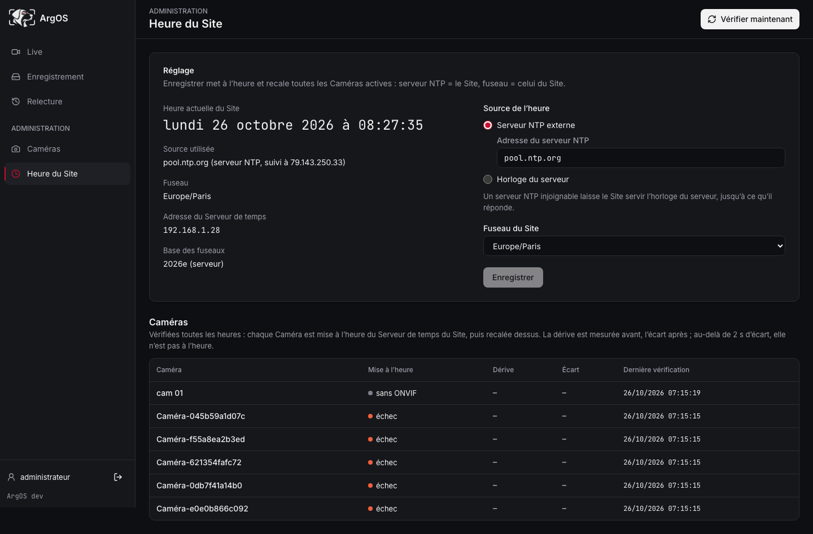

# Serveur de temps et calage des Caméras

Comment le Site donne l’heure aux Caméras, ce qu’il envoie comme fuseau (surtout au changement d’heure), ce qu’il ne fait **pas**, et ce que ça implique pour l’incrustation Live et pour les enregistrements.

Décisions : [ADR 0014](../../adr/0014-serveur-de-temps-du-site.md) (Serveur de temps), [ADR 0015](../../adr/0015-mise-a-l-heure-a-chaque-verification.md) (Mise à l’heure + décalage du moment + base des fuseaux). Termes : [Heure du Site](../../glossaire.md#heure-du-site), [Horloge](../../glossaire.md#horloge), [Serveur de temps du Site](../../glossaire.md#serveur-de-temps-du-site), [Mise à l’heure](../../glossaire.md#mise-a-l-heure). Caméras essayées : [Caméras qualifiées](../../cameras/compatibilite.md). Limites réseau / NTP : [sécurité](../../securite.md#réseau-des-caméras--une-sortie-et-ntp).

## En bref

- **`temps`** (chrony) sert l’heure en **NTP (UTC)** sur le réseau des caméras. Il ne règle jamais l’horloge de l’hôte.
- L’**Heure du Site** (page Admin) fixe la **source** NTP (ex. `pool.ntp.org`) et le **fuseau** (ex. `Europe/Paris`).
- À chaque **vérification**, le Site **met à l’heure** puis **cale** chaque Caméra ONVIF active : UTC lue chez `temps` + **décalage du moment** du fuseau du Site (sans règles d’heure d’été).
- La référence, c’est toujours le Site. ArgOS **ne** calcule **pas** un fuseau « compensateur » à partir d’un décalage faux lu sur la caméra.
- Les **Segments** d’enregistrement sont horodatés en **UTC** : au passage 3 h → 2 h, rien n’est réécrit ; deux instants locaux « 02 h » restent deux fichiers distincts. L’UI peut afficher le même libellé murale deux fois.

## Schéma

```text
Internet (pool.ntp.org…)              Caméras
        │                                ▲
        ▼                                │ NTP (UTC) + ONVIF
   ┌─────────┐                     ┌──────────┐
   │  temps  │ ──── NTP ─────────► │ Caméras  │  incrustation = heure locale
   └─────────┘                     └──────────┘
        ▲                                ▲
        │ lit / pilote                   │ Mise à l’heure + calage
   ┌─────────┐                           │
   │   api   │───────────────────────────┘
   └─────────┘
   Heure du Site = source + fuseau (Europe/Paris…)
```

Sans macvlan (Mac / Docker Desktop), `temps` publie `123/udp` sur l’hôte. En prod Linux avec réseau des caméras, `temps` a sa propre IP macvlan et ne sert que le NTP ([ADR 0014](../../adr/0014-serveur-de-temps-du-site.md)).

## Heure du Site

Réglages (persistés) :

| Réglage | Rôle |
| --- | --- |
| Source | `ntp` (serveur nommé) ou horloge du serveur (repli) |
| Serveur NTP | ex. `pool.ntp.org` — transmis à `temps` via le volume `reglage-temps` |
| Fuseau | ex. `Europe/Paris` — défaut = fuseau de l’hôte |

La page **Heure du Site** affiche aussi la **base des fuseaux** utilisée pour calculer les décalages (`2026e (serveur)` = base de l’hôte ; sinon base embarquée dans l’image). Voir [second avenant ADR 0015](../../adr/0015-mise-a-l-heure-a-chaque-verification.md#second-avenant-091--base-des-fuseaux-de-lhôte-dabord).



## Ce que le Site envoie à une Caméra

Depuis la 0.9.1, pour `Europe/Paris` :

| Moment | Décalage envoyé (POSIX simplifié) | Sens |
| --- | --- | --- |
| Heure d’été | `CEST-2` | UTC+2 |
| Heure d’hiver | `CET-1` | UTC+1 |

- **Pas** la chaîne complète avec règles d’heure d’été (`CET-1CEST,M3.5.0,M10.5.0/3`) : beaucoup de caméras (ex. [Cam 01](../../cameras/compatibilite.md#cam-01)) ne les appliquent pas et restent bloquées à un mauvais offset.
- `DaylightSavings` est toujours envoyé à **`false`** : on ne compte pas sur la caméra pour « savoir » qu’on a changé d’heure.
- Si l’abréviation n’est pas utilisable (`+01`, `UTC`, `GMT`), le Site envoie un nom neutre (`ARGOS-1`, `ARGOS0`).

### Ce que le Site ne fait pas

Il **ne** lit **pas** un fuseau faux sur la caméra pour en déduire un offset qui « annule » l’écart.

Enchaînement réel :

1. Calculer le décalage **juste** du fuseau du Site (base des fuseaux).
2. Pousser UTC + ce décalage (Mise à l’heure), puis recaler en NTP vers le Serveur de temps.
3. Relire l’Horloge : écart ≤ 2 s **et** bon décalage → « à l’heure » ; sinon → **« écart »** (journal API).

Exemple : caméra coincée en UTC+2 en hiver → le Site continue d’envoyer `CET-1` aux vérifs suivantes ; il ne lui envoie pas un « UTC+0 compensateur ».

## Quand a lieu une vérification

- Ajout d’une Caméra / changement de l’Heure du Site.
- **Toutes les heures.**
- Bouton **« Vérifier maintenant »**.
- **À l’instant exact** de chaque changement d’heure du fuseau du Site (recalculé après chaque changement et à chaque changement de fuseau).

À chaque vérification ONVIF active : Mise à l’heure puis calage ([ADR 0015](../../adr/0015-mise-a-l-heure-a-chaque-verification.md)).

Site arrêté pendant un changement d’heure : au redémarrage, la vérification horaire reprend et corrige.

## Exemple concret : passage 3 h → 2 h (France)

Dimanche de passage à l’heure d’hiver (3 h légales → 2 h) :

1. La base des fuseaux sait que `Europe/Paris` passe de UTC+2 à UTC+1.
2. ArgOS a mémorisé l’instant du prochain changement.
3. À cet instant, vérification de **toutes** les Caméras actives.
4. Chaque Caméra ONVIF reçoit `CET-1` (plus l’UTC de `temps`), puis le calage NTP.
5. Quelques secondes peuvent séparer le coup d’horloge légal et la fin de la vérif : une caméra peut encore afficher l’ancien décalage le temps de la passe.

L’UTC côté NTP **ne recule pas**. Seul l’affichage / l’incrustation locale change de décalage.

## Enregistrements et relecture

Les Segments fMP4 sont nommés et lus en **heure UTC du conteneur** (`%Y-%m-%d_%H-%M-%S-%f`, voir `api/argos_api/segments_fermes.py`). La relecture demande un `start` en RFC 3339 (absolu).

Au passage 3 h → 2 h :

- **Rien n’est réécrit** ni écrasé pour « libérer » l’heure locale.
- Les deux plages locales « 02 h – 03 h » de ce dimanche correspondent à **deux intervalles UTC distincts** → deux suites de Segments distincts.
- La timeline ordonne au temps réel (UTC), pas à l’horloge murale ambiguë.

### Affichage dans l’UI

Les libellés de relecture passent par l’heure locale du navigateur (`toLocaleString` / `toLocaleTimeString`). Il n’y a **pas** de mode « deux fuseaux » ni de sélecteur « première / deuxième 2 h ».

Conséquence : deux Segments distincts peuvent afficher le **même** texte « 02:15 ». L’ordre sur la timeline et le `start` cliqué restent univoques.

*(Si l’horloge de l’hôte est fausse et que `temps` est en repli dessus, les Segments peuvent être mal datés — limite ADR 0014, indépendante du changement d’heure.)*

## Compatibilité caméras

La stratégie « décalage du moment » vise à marcher :

- pour une caméra qui **ignore** l’heure d’été ;
- pour une caméra qui **saurait** l’appliquer (on ne lui demande pas).

Ce n’est **pas** une garantie pour toute caméra du marché :

- sans ONVIF utile → pas de calage (« sans ONVIF ») ;
- comportement exotique (sens de `UTC` inversé, refus du mode manuel, autre décalage gardé) → **« écart »** jusqu’à qualification ou bug.

Procédure et liste : [Caméras qualifiées](../../cameras/compatibilite.md).

## Voir aussi

- Page Admin **Heure du Site** (source, fuseau, base des fuseaux, tableau des Caméras).
- [Paramétrer une Caméra](../../cameras/parametrer-une-camera.md) (ONVIF, essais manuels).
- [Inspecter les enregistrements](../../cameras/inspecter-les-enregistrements.md) (volume, noms de Segments).
