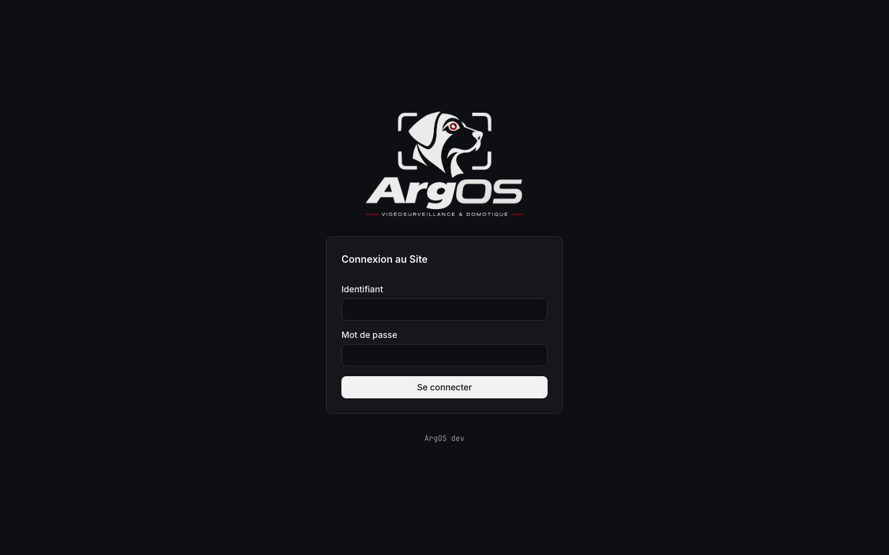

# Installer l’Autorité du Site

Depuis la 0.6.1, le Site n’est servi qu’en **HTTPS**, à l’adresse `https://<IP du Site>`. Le Site n’a pas de nom de domaine public : aucune autorité d’internet ne peut lui signer un certificat. ArgOS crée donc sa propre **Autorité du Site**, qui signe le certificat du serveur. Une fois installée sur un poste (Mac, iPhone, PC, Android), le navigateur de ce poste reconnaît le Site, sans avertissement.

À faire **une fois par poste**. Pourquoi ce choix : [ADR 0005](../../adr/0005-https-par-une-origine-unique-et-une-autorite-du-site.md). Où passe le trafic : [Schéma du réseau et des Flux](schema-flux.md). Ce que l’Autorité permet à qui la détient : [sécurité](../../securite.md#une-origine-https).

## 1. Avant de commencer

- L’IP du Site sur le réseau local doit être déclarée dans `.env` (`MTX_WEBRTCADDITIONALHOSTS`, par exemple `192.168.1.20`) : le certificat serveur nomme `localhost`, `127.0.0.1` et cette IP, rien d’autre. Sans elle, le Site n’est reconnu que depuis la machine hôte.
- **Ne jamais cliquer sur « continuer quand même »** devant un avertissement du navigateur. Un avertissement veut dire : Autorité pas installée sur ce poste, adresse que le certificat ne nomme pas, ou quelqu’un qui se fait passer pour le Site. Dans les trois cas, on corrige ; on ne passe pas outre.

## 2. Télécharger l’Autorité

Depuis le poste, ouvrir **`http://<IP du Site>/argos-ca.crt`** (en `http://`, sans `s` : le poste ne connaît pas encore l’Autorité). Si le port HTTP a été changé dans `.env` (`ARGOS_PORT_HTTP`), l’ajouter : `http://<IP du Site>:<port>/argos-ca.crt`. Le port `8080` sert le même fichier.

Ce fichier n’est que la **partie publique** de l’Autorité : il ne permet de rien signer. Mais il passe en clair sur le réseau local : un poste malveillant pourrait le remplacer en route par le sien. D’où l’empreinte, à comparer avant de faire confiance.

Avec un certificat fourni par l’Administrateur (§ 6), `/argos-ca.crt` répond `404` : il n’y a rien à installer.

## 3. Comparer l’empreinte

L’**empreinte SHA-256** identifie l’Autorité : 32 octets en hexadécimal, `AB:12:…`. Celle du fichier téléchargé doit être **exactement** celle que le Site affiche :

- dans les journaux du service `certificats`, à chaque démarrage :

  ```bash
  docker compose logs certificats | grep Empreinte
  # Empreinte SHA-256 de l'Autorité du Site : AB:12:…
  ```

- dans la fenêtre de `lancer-argos.command`, sur le Mac hôte (étape 4).

Comparer **toute** l’empreinte, pas seulement le début. Différente : ne pas installer, chercher qui sert ce fichier sur le réseau.

Sur chaque système, la façon de lire l’empreinte est donnée plus bas. En ligne de commande, partout où `openssl` existe :

```bash
openssl x509 -in argos-ca.crt -noout -fingerprint -sha256
```

## 4. Installer, système par système

### macOS

**Le Mac hôte** : `lancer-argos.command` affiche l’empreinte et, si l’Autorité n’est pas dans le trousseau de session, demande (`o` / `n`) avant de l’y ajouter ; macOS demande alors le mot de passe de la session. Il ne redemande pas une fois l’Autorité installée.

**Un autre Mac** :

1. Télécharger `argos-ca.crt` (§ 2) et vérifier l’empreinte : `openssl x509 -in ~/Downloads/argos-ca.crt -noout -fingerprint -sha256`.
2. Double-cliquer sur le fichier : **Trousseaux d’accès** l’ajoute au trousseau **session**.
3. Dans Trousseaux d’accès, double-cliquer sur **Autorité du Site ArgOS** → **Se fier** → « Lors de l’utilisation de ce certificat » : **Toujours approuver**. Fermer la fenêtre ; macOS demande le mot de passe.

En une commande, à la place des étapes 2 et 3 :

```bash
security add-trusted-cert -r trustRoot -k ~/Library/Keychains/login.keychain-db ~/Downloads/argos-ca.crt
```

Safari, Chrome et Edge lisent le trousseau. Firefox aussi en général ; s’il avertit encore : **Paramètres** → **Vie privée et sécurité** → **Afficher les certificats** → **Autorités** → **Importer**, cocher « Confirmer cette AC pour identifier des sites web ».

### iOS et iPadOS

1. Dans **Safari** (pas un autre navigateur), ouvrir `http://<IP du Site>/argos-ca.crt` → **Autoriser** : « Profil téléchargé ».
2. **Réglages** → **Profil téléchargé** (en haut) → **Installer**, code de l’appareil, **Installer**.
3. Vérifier l’empreinte : **Réglages** → **Général** → **VPN et gestion de l’appareil** → **Autorité du Site ArgOS** → **Plus de détails** → le certificat → **Empreintes**, ligne SHA-256. Différente : **Supprimer le profil**.
4. Activer la confiance, **indispensable** : **Réglages** → **Général** → **Informations** → **Réglages des certificats** (tout en bas) → activer **Autorité du Site ArgOS** → **Continuer**.

Sans l’étape 4, le profil est installé mais Safari avertit toujours.

### Windows

1. Télécharger `argos-ca.crt` (§ 2).
2. Vérifier l’empreinte, dans PowerShell, depuis le dossier du fichier :

   ```powershell
   $c = New-Object Security.Cryptography.X509Certificates.X509Certificate2 (Resolve-Path .\argos-ca.crt).Path
   [BitConverter]::ToString([Security.Cryptography.SHA256]::Create().ComputeHash($c.RawData))
   ```

   Windows sépare les octets par des tirets (`AB-12-…`) au lieu des deux-points : seuls les caractères comptent. (L’« empreinte numérique » de la fenêtre du certificat est en SHA-1 : elle ne se compare pas à celle du Site.)
3. Installer, au choix :
   - double-cliquer sur le fichier → **Installer un certificat…** → **Utilisateur actuel** → **Placer tous les certificats dans le magasin suivant** → **Parcourir** → **Autorités de certification racines de confiance** → **Terminer**, puis **Oui** à l’avertissement de sécurité ;
   - ou, dans PowerShell : `Import-Certificate -FilePath .\argos-ca.crt -CertStoreLocation Cert:\CurrentUser\Root`.
4. Fermer et rouvrir le navigateur.

Chrome et Edge lisent le magasin de Windows. Firefox aussi en général ; sinon, comme sur macOS (**Importer** dans ses Autorités).

### Android

Les menus varient selon le fabricant ; les noms ci-dessous sont ceux d’Android 14 (Pixel).

1. Télécharger `argos-ca.crt` dans Chrome (§ 2) : il arrive dans **Téléchargements**. Android refuse d’installer une Autorité depuis le navigateur lui-même.
2. **Paramètres** → **Sécurité et confidentialité** → **Plus de paramètres de sécurité** → **Chiffrement et identifiants** → **Installer un certificat** → **Certificat CA** → **Installer quand même**, puis choisir `argos-ca.crt`. (Ailleurs, chercher « certificat » dans la barre de recherche des Paramètres.)
3. Vérifier l’empreinte : même écran → **Identifiants de confiance** → onglet **Utilisateur** → **Autorité du Site ArgOS** : l’empreinte SHA-256 est en bas. Différente : **Supprimer**.

Chrome accepte les Autorités installées par l’utilisateur. Firefox pour Android ne le fait qu’avec le réglage « Utiliser des certificats d’AC tiers » (menu de débogage de ses paramètres) ; préférer Chrome.

## 5. Vérifier

Ouvrir **`https://<IP du Site>`** : le cadenas s’affiche, sans avertissement. Une ancienne adresse (`http://<IP du Site>:8080`) redirige vers elle.



Si le navigateur avertit encore :

- **l’adresse n’est pas nommée** par le certificat (IP oubliée ou changée dans `MTX_WEBRTCADDITIONALHOSTS`, nom d’hôte au lieu de l’IP) : corriger `.env`, puis relancer la stack (`lancer-argos.command`, ou `docker compose up -d`) ; le certificat serveur est régénéré et servi au lancement, rien à refaire sur les postes ;
- **l’Autorité n’est pas approuvée** sur ce poste (iOS : étape 4 oubliée ; Windows : mauvais magasin) ;
- **l’Autorité a changé** (§ 7) : l’empreinte du poste ne correspond plus à celle des journaux.

## 6. Certificat fourni par l’Administrateur

Avec son propre certificat (nom de domaine, VPN qui délivre des certificats), l’Administrateur se passe de l’Autorité du Site :

1. Dans un dossier de la machine hôte, déposer `certificat.crt` (le certificat du Site, **chaîne comprise**) et `cle.key` (sa clé).
2. Dans `.env` : `ARGOS_CERTIFICAT_DOSSIER=<chemin du dossier>` (absolu, ou relatif au dépôt).
3. Arrêter et relancer la stack (`docker compose down`, puis `up`).

ArgOS sert alors ces fichiers **tels quels** : ni Autorité, ni génération, ni renouvellement. `/argos-ca.crt` répond `404`, et `lancer-argos.command` ne propose rien. Les postes reconnaissent le Site s’ils font déjà confiance à l’autorité qui a signé ce certificat. Fichier manquant ou vide : le Site ne démarre pas, et `docker compose logs certificats` dit lequel.

Renouveler le certificat avant son expiration est à la charge de l’Administrateur : remplacer les deux fichiers, puis arrêter et relancer la stack. Vider `ARGOS_CERTIFICAT_DOSSIER` revient à l’Autorité du Site (celle déjà créée, si son volume existe encore).

## 7. Perdre l’Autorité du Site

La clé de l’Autorité vit dans le volume Docker **`autorite`** (`argos_autorite` sur un dépôt nommé `ArgOS`), et nulle part ailleurs : la 0.6.1 n’en fait ni sauvegarde ni export. Elle est créée au premier lancement, valable **10 ans**, et jamais remplacée tant que le volume existe.

Le volume disparaît avec `docker compose down -v` (qui efface aussi la base), `docker volume rm`, ou une réinstallation de Docker. Au lancement suivant, ArgOS crée une **nouvelle** Autorité, avec une autre empreinte. Alors :

- **tous les postes** avertissent de nouveau : sur chacun, supprimer l’ancienne **Autorité du Site ArgOS** et installer la nouvelle (§ 2 à § 4) ;
- l’ancienne empreinte ne doit plus être acceptée nulle part.

Le certificat serveur, lui, se renouvelle seul : **397 jours**, régénéré au démarrage s’il lui reste moins de 30 jours, ou si l’IP du Site a changé, toujours avec la même Autorité. Rien à refaire sur les postes. Il n’est régénéré qu’au lancement de la stack (`lancer-argos.command`, ou `docker compose up -d`), et nginx (`web`) sert le nouveau sans arrêt ni redémarrage : pour une stack qui tourne depuis près d’un an, la relancer suffit.
