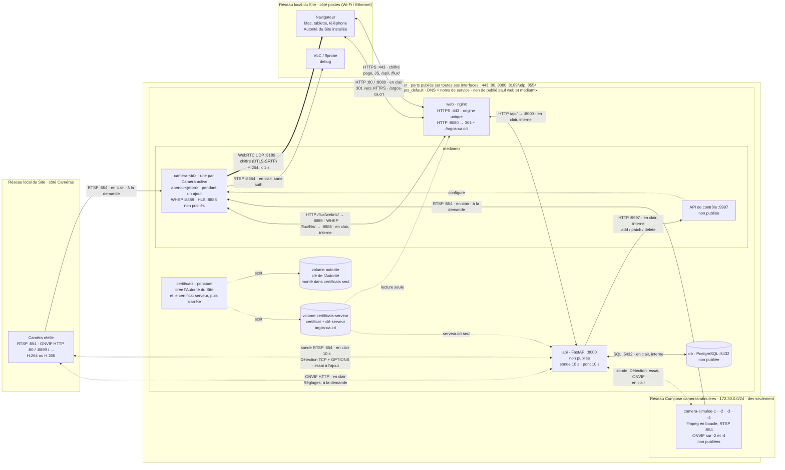

# Schéma du réseau et des Flux

Tout ce qui circule dans un Site ArgOS 0.6.1, des Caméras jusqu’au navigateur : protocoles, ports, réseaux et conteneurs, et pour chaque flux s’il est **chiffré** ou **en clair**. Source de vérité : `compose.yaml` (prod), `compose.simulation.yaml` (Caméras simulées, dev seulement), `compose.reseau-cameras.yaml` (réseau des caméras, prod Linux), `web/nginx.conf.template` (l’origine HTTPS), `media/mediamtx.yml`, [ADR 0001](../../adr/0001-mediamtx-en-pont.md) (MediaMTX en pont), [ADR 0004](../../adr/0004-hls-pour-les-flux-h265.md) (HLS pour les Flux H.265), [ADR 0005](../../adr/0005-https-par-une-origine-unique-et-une-autorite-du-site.md) (HTTPS par une origine unique). Installer l’Autorité du Site sur un poste : [Installer l’Autorité du Site](installer-l-autorite-du-site.md). Limites de sécurité : [sécurité](../../securite.md).

## En bref

- Le navigateur ne parle au Site que par **une seule origine HTTPS** : `https://<IP du Site>` (port `443`). Le nginx du conteneur `web` y sert l’UI et relaie l’API (`/api/`) et le Live (`/flux/webrtc/`, `/flux/hls/`).
- Les ports HTTP `80` et `8080` ne font que **rediriger** vers HTTPS, et servir la partie publique de l’Autorité du Site (`/argos-ca.crt`).
- Hors de l’origine HTTPS, la machine hôte ne publie plus que la vidéo WebRTC (`8189/udp`, chiffrée) et **RTSP `8554`** (en clair, sans authentification jusqu’à la 0.6.2).
- Le service ponctuel `certificats` crée l’Autorité du Site et le certificat serveur avant `web`, puis s’arrête.
- Côté Caméras, rien ne change : RTSP et ONVIF restent **en clair** sur le réseau des caméras.

## Schéma

Lecture : trait plein = flux continu ou à la demande ; trait épais = vidéo vers le navigateur ; pointillés = sonde, pilotage et fichiers ; double flèche = requête / réponse. Chaque étiquette dit **chiffré** ou **en clair**. Les deux cadres « Réseau local du Site » sont **le même** réseau, coupé en deux pour que la vidéo se lise de gauche à droite.



Le schéma ne montre pas la Détection qui frappe à l’hôte du Site lui-même (HTTPS `:443`, voir [Détection](#détection)), ni le réseau des caméras en macvlan de la prod Linux ([ADR 0003](../../adr/0003-macvlan-sur-la-prise-des-cameras.md)) : `api` y parle aux mêmes caméras, sans NAT, et n’y sert aucune requête.

## L’origine HTTPS

Le nginx de `web` est la seule porte du Site pour un navigateur. Il termine le TLS avec le certificat serveur (volume `certificats-serveur`, lecture seule), puis relaie en HTTP, **à l’intérieur** du réseau Compose :

| Chemin sous `https://<IP du Site>` | Vers | Ce qui passe |
|---|---|---|
| `/` (et `/connexion`, `/administration`, `/live`) | fichiers de `web` | `index.html` et le JS de l’UI |
| `/api/…` | `api:8000` | JSON, cookie `argos_session` (`Secure; HttpOnly; SameSite=Lax`) |
| `/flux/webrtc/<chemin>/whep` (puis `PATCH`, `DELETE` sur la session) | `mediamtx:8889` | signalisation WHEP : offre / réponse SDP, candidats ICE |
| `/flux/hls/<chemin>/index.m3u8`, variantes, segments | `mediamtx:8888` | LL-HLS fMP4 H.265, sans mise en tampon |
| `/argos-ca.crt` | volume `certificats-serveur` | partie publique de l’Autorité du Site (`404` avec un certificat fourni) |

`<chemin>` est `camera-<id>` (une Caméra active) ou `apercu-<jeton>` (l’Aperçu pendant un ajout). L’UI n’utilise que des URL relatives : un seul nom d’hôte, un seul certificat, plus de CORS.

Sur les ports HTTP (`80` et `8080` de l’hôte, `8080` dans le conteneur), nginx ne sert que `/argos-ca.crt` ; tout le reste reçoit un `301` vers `https://<même hôte><même chemin>`. Les ports se règlent dans `.env` : `ARGOS_PORT_HTTPS` (`443`), `ARGOS_PORT_HTTP` (`80`), `ARGOS_PORT_HTTP_ANCIEN` (`8080`).

## Les Flux, un par un

| De → vers | Protocole · port | Chiffré ? | Quand | Ce qui passe |
|---|---|---|---|---|
| navigateur → `web` | HTTPS · `:443` | **chiffré** (TLS) | à chaque page, appel d’API, Live, Aperçu | l’UI, `/api/…`, `/flux/…` (tableau ci-dessus) : mot de passe de l’Administrateur, cookie de session, identifiants de caméra saisis à l’ajout, jeton de l’Aperçu |
| navigateur → `web` | HTTP · `:80`, `:8080` | en clair | ancienne adresse, adresse tapée en `http://`, téléchargement de l’Autorité | `301` vers HTTPS ; `/argos-ca.crt` (public, à vérifier par son empreinte). Le cookie de session n’y est jamais envoyé (`Secure`) |
| `web` → `api` | HTTP · `api:8000` | en clair, réseau Compose | à chaque requête `/api/…` | relais de l’API ; ne sort pas de la machine hôte |
| `web` → `mediamtx` | HTTP · `mediamtx:8889` (WHEP), `mediamtx:8888` (HLS) | en clair, réseau Compose | à chaque Caméra affichée dans le Live, et à l’Aperçu | relais de la signalisation WHEP et du LL-HLS ; ne sort pas de la machine hôte |
| `mediamtx` → navigateur | WebRTC · UDP `:8189` | **chiffré** (DTLS-SRTP) | pendant le Live ou l’Aperçu d’une Caméra H.264 (ou au codec inconnu), une connexion par vue | vidéo H.264, hors de l’origine HTTPS |
| VLC / ffprobe → `mediamtx` | RTSP · `:8554` | **en clair, sans authentification** (jusqu’à la 0.6.2) | à la demande | lecture directe des `camera-<id>`, et de l’`apercu-<jeton>` pendant un ajout (debug) |
| `certificats` → volumes | fichiers | — | à chaque `docker compose up`, avant `web` et `api` | crée l’Autorité si elle manque ; crée ou garde le certificat serveur ; copie `argos-ca.crt` |
| `api` → `db` | SQL · `db:5432` | en clair, réseau Compose | à chaque requête | Caméras, sessions, états |
| `api` → `mediamtx` | HTTP · `mediamtx:9997` (API de contrôle) | en clair, réseau Compose | toutes les 10 s ; au Flux trouvé, à l’ajout, à l’annulation, à l’expiration d’un Aperçu | ajoute / modifie / retire les chemins `camera-<id>` et `apercu-<jeton>` |
| `api` → chaque Caméra active | RTSP/TCP · `:554` | en clair | toutes les 10 s, quelques ms | `DESCRIBE`, `SETUP`, `PLAY`, un paquet vidéo, `TEARDOWN` → `online` / `offline` |
| `api` → chaque adresse des sous-réseaux autorisés | TCP · ports caméra (`554,8554` par défaut), puis RTSP `OPTIONS` | en clair | à chaque Détection (clic dans l’Administration), une dizaine de secondes | connexion, puis `OPTIONS` sans chemin ni identifiants ; une ligne de statut RTSP en retour → Candidat |
| `api` → chaque Candidat | HTTPS · `:443` (`ARGOS_PORT_HTTPS`) `GET /api/instance` | **chiffré** (TLS) | à chaque Détection, Candidats seulement | jeton d’instance, et certificat présenté comparé à celui du Site : l’hôte d’ArgOS est écarté |
| `api` → un Candidat (ou une IP saisie) | RTSP/TCP · son port (`554` par défaut) | en clair (identifiants en Digest ou en Basic, selon la caméra) | à chaque essai d’ajout, un à la fois | `OPTIONS`, puis `DESCRIBE` sur les chemins courants jusqu’au premier `200`, puis la sonde ([Ajouter une Caméra](../../cameras/ajouter-une-camera.md)) |
| `api` → une Caméra active | HTTP · port ONVIF (`80`, `8899`, `2000`, `8000`, `8080` essayés) | en clair (mot de passe en empreinte WS-Security) | à l’ouverture et à l’enregistrement des Réglages | lecture et réglage des Incrustations et de l’Horloge ([Paramétrer une Caméra](../../cameras/parametrer-une-camera.md)) |
| `mediamtx` (`camera-<id>`) → source de la Caméra | RTSP/TCP | en clair | seulement pendant qu’un poste regarde | le Flux de la Caméra, relayé sans réencodage |
| `mediamtx` (`apercu-<jeton>`) → Candidat | RTSP/TCP | en clair | pendant qu’un ajout montre l’Aperçu | le Flux du Candidat, identifiants de l’essai compris |
| ffmpeg → Caméra simulée (son chemin) | RTSP · `127.0.0.1:554`, dans chaque conteneur `camera-simulee-N` | en clair, dans le conteneur | en continu (dev) | la vidéo de dev, sans réencodage |

## Ports et réseaux

- **Ports publiés** sur la machine hôte, donc joignables depuis tout le réseau local :

  | Port | Service | Rôle | Chiffré ? |
  |---|---|---|---|
  | `443/tcp` | `web` | le Site : UI, API, signalisation WHEP, HLS | **oui** (TLS) |
  | `80/tcp`, `8080/tcp` | `web` | redirection vers HTTPS, `/argos-ca.crt` | non (rien de secret) |
  | `8189/udp` | `mediamtx` | média WebRTC | **oui** (DTLS-SRTP) |
  | `8554/tcp` | `mediamtx` | RTSP, lecture directe des Flux | **non**, sans authentification (0.6.2) |

- **Fermés depuis la 0.6.1** : `8000` (API), `8888` (HLS), `8889` (WHEP). Ils n’écoutent plus que dans le réseau Compose, derrière `web`. Jamais publiés : `5432` (PostgreSQL), `9997` (API de contrôle de MediaMTX).
- **Réseau Compose `argos_default`** : un réseau Docker privé, créé par `docker compose`. Les conteneurs s’y joignent par leur nom de service (`db`, `mediamtx`, `api`, `web`, `certificats`). Il est **le seul** à voir `api:8000`, `mediamtx:8888`, `mediamtx:8889`, `mediamtx:9997` et `db:5432`. Ce qui y circule en clair ne quitte pas la machine hôte.
- **Volumes de certificats** : `autorite` (clé et certificat de l’Autorité du Site), monté **seulement** dans `certificats` ; `certificats-serveur` (certificat serveur, sa clé, `argos-ca.crt`), écrit par `certificats`, monté en lecture seule dans `web`, et dans `api` pour le seul certificat serveur (sans clé), qui sert à la Détection à reconnaître l’hôte du Site.
- **Réseau Compose `cameras-simulees`** (dev seulement, `compose.simulation.yaml`) : sous-réseau fixe `172.30.0.0/24`, où vivent les quatre Caméras simulées. `api` (sonde, Détection, ONVIF) et `mediamtx` (pont) le rejoignent et les y joignent comme de vraies caméras. La stack de prod (`compose.yaml` seul) n’a ni ce réseau ni Caméras simulées.
- **Réseau des caméras** (prod Linux, `compose.reseau-cameras.yaml`) : `api` y gagne une interface macvlan, pour lire les adresses MAC ; toute requête qui y arrive est refusée ([ADR 0003](../../adr/0003-macvlan-sur-la-prise-des-cameras.md)).
- **Réseau local du Site** (Wi-Fi ou Ethernet) : les navigateurs y joignent la machine hôte par son IP, et la machine hôte y joint les Caméras réelles. Docker Desktop fait sortir `api` et `mediamtx` vers ce réseau par la machine hôte (NAT).
- **IP du Site** (`MTX_WEBRTCADDITIONALHOSTS` dans `.env`) : MediaMTX l’annonce pour WebRTC, et le certificat serveur la nomme, avec `localhost` et `127.0.0.1`. Sans elle, le Site n’est joignable en HTTPS valide, et le Live en WebRTC, que depuis la machine hôte. Si elle change, le certificat serveur est régénéré au démarrage suivant, avec la même Autorité.

## Ce qui reste en clair

- **RTSP `8554`** : tout poste du réseau local lit les Flux de toutes les Caméras actives, sans mot de passe ni chiffrement, jusqu’à l’authentification des Flux (0.6.2).
- **Vers les caméras** : RTSP (Flux, sonde, Détection, essai) et ONVIF partent en clair sur le réseau des caméras, jusqu’à la sécurisation d’ONVIF (0.6.3).
- **Dans la machine hôte** : `web` relaie en HTTP vers `api` et `mediamtx`, sur le réseau Compose ; rien de ce trafic ne sort sur le réseau local.
- **`/argos-ca.crt` en HTTP** : un poste du réseau pourrait le remplacer en route ; d’où l’empreinte à comparer avant de l’installer ([Installer l’Autorité du Site](installer-l-autorite-du-site.md#3-comparer-lempreinte)).

## Détection

La Détection n’est pas un Flux vidéo : c’est un balayage court, lancé par l’Administrateur, qui part de `api`. Les sous-réseaux balayés viennent de la machine hôte, hors de Docker : `scripts/cameras/configurer-detection.sh` lit l’adresse de la ou des prises des caméras et l’écrit dans `.env` (`ARGOS_DETECTION_CAMERAS_SOUS_RESEAUX`), que Compose passe à `api` au démarrage ([ADR 0002](../../adr/0002-detection-depuis-le-reseau-bridge.md)) ; en dev, `compose.simulation.yaml` y ajoute `172.30.0.0/24`.

```
machine hôte : configurer-detection.sh ──écrit──▶ .env ──Compose──▶ api
navigateur ──HTTPS POST /api/detection──▶ web ──▶ api ──TCP + RTSP OPTIONS──▶ sous-réseaux autorisés
                                                  api ──HTTPS GET /api/instance :443──▶ Candidats (écarte ArgOS)
                                                  api ◀──SQL──▶ db (Caméras déjà configurées)
```

L’hôte du Site publie le pont (RTSP `8554`), qui répond comme une caméra. Pour l’écarter, `api` demande `GET /api/instance` à chaque Candidat sur le port HTTPS du Site, et ne le reconnaît que s’il renvoie le jeton de cette instance **avec** exactement le certificat du Site (seule cette machine a sa clé).

Explication complète, ce qu’elle envoie et ce qu’elle ne fait pas : [Réseau du Site et Détection des Caméras](../../cameras/reseau-et-detection.md) ; limites : [sécurité](../../securite.md#détection--argos-agit-sur-le-réseau).
